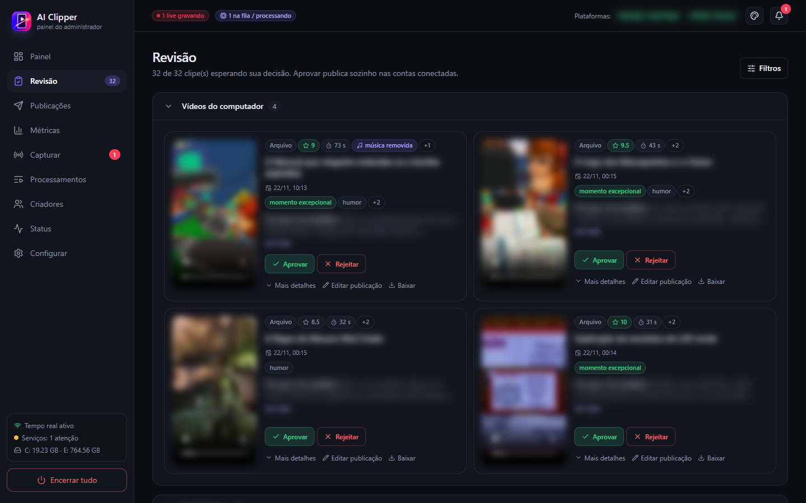
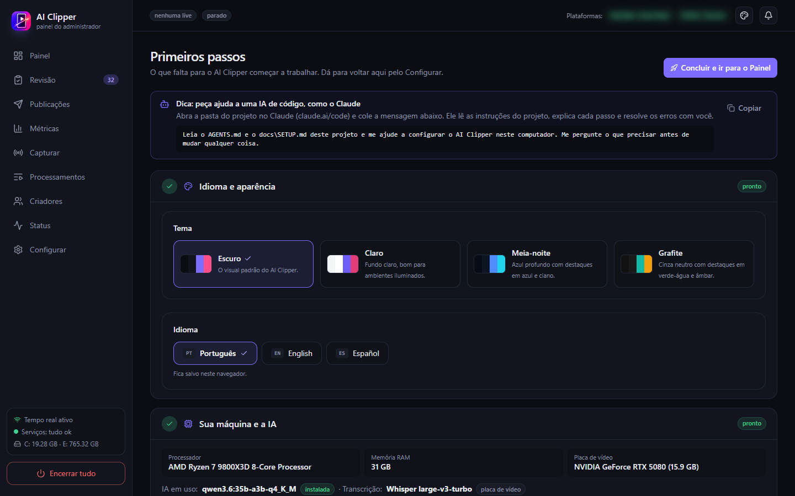

# AI Clipper

**Corta lives e vídeos em clipes verticais com IA, direto no seu computador.** Você revisa e aprova; ele publica no YouTube e no TikTok. *(English and Español below.)*

- Grava lives da Twitch em tempo real, pega a última live, clipes da Twitch, links e vídeos do computador.
- IA local escolhe os melhores momentos, um juiz com visão confere, e gera clipes 9:16 legendados com título, gancho e hashtags.
- Detecta e tira música protegida, mantendo a voz.
- Revisão no site ou no Telegram, publicação no YouTube e TikTok, métricas e aprendizado com as suas decisões.
- **100% local:** sem nuvem, sem servidor, sem conta no AI Clipper. Seus vídeos e dados não saem do seu computador.
- Português, English e Español. Tema escuro e claro.

| Revisão | Primeiros passos |
|---|---|
|  |  |

## Baixar e instalar

**[⬇ Baixar a última versão](https://github.com/Gabriel-Bastiani/ai-clipper-download/releases/latest)**

Na página que abrir, em **Assets**, baixe **só o arquivo `AI-Clipper-Setup-X.Y.Z.exe`**, abra e siga as telas. Mais nada.

- Cada tela explica a escolha. O instalador detecta a sua máquina e recomenda a IA certa.
- Se o Windows avisar "O Windows protegeu o computador", clique em **Mais informações → Executar assim mesmo** (o instalador ainda não tem o certificado pago do Windows).
- Os outros arquivos da página não são para baixar: o `.zip` e o `latest.json` são usados pelas atualizações automáticas, e os "Source code" o GitHub cria sozinho em toda Release.

Opcional: depois de instalar, dá para abrir a pasta do AI Clipper no Claude ou em outra IA de código e pedir para ela ler o `GUIA-PARA-IA.md`, para ajudar na configuração.

**Requisitos:** Windows 10/11 64 bits. Placa NVIDIA recomendada (funciona sem, mais devagar). 20 a 60 GB livres em qualquer disco, conforme o modelo de IA, mais espaço para os vídeos.

## Atualizações (automáticas)

Você instala uma vez e não precisa baixar mais nada. Quando sai uma versão nova, ela chega sozinha:

1. Ao ligar, e a cada 6 horas com ele aberto, o AI Clipper confere aqui se há versão nova. Só precisa de internet: **não precisa de conta no GitHub** nem de nenhum programa a mais.
2. Se houver, ele baixa o pacote e confere a assinatura digital (só aceita versões publicadas pelo autor). Com ele aberto, o sininho avisa.
3. Na próxima vez que você ligar o AI Clipper (ou na hora, em **Sobre → Atualizar agora**), ele já abre na versão nova. Faz backup antes e, se algo falhar, volta sozinho para a versão anterior. Seus vídeos, dados, chaves e configurações não são tocados.

As novidades de cada versão ficam na tela **Sobre**. A atualização automática pode ser desligada em Configurar → Sistema.
## Privacidade e licença

Tudo roda no seu computador; o autor não recebe nenhum dado seu. Uso pessoal gratuito; não é permitido copiar, redistribuir, modificar ou fazer engenharia reversa: veja a [licença de uso](LICENSE.txt). Você é responsável por ter autorização para o conteúdo que corta e publica. Componentes de terceiros: [THIRD-PARTY-NOTICES.txt](THIRD-PARTY-NOTICES.txt).

Este repositório só tem os arquivos de instalação; o código-fonte é privado.

---

### English

AI Clipper cuts live streams and videos into vertical clips with AI, entirely on your computer. You review and approve; it publishes to YouTube and TikTok. **[Download the latest version](https://github.com/Gabriel-Bastiani/ai-clipper-download/releases/latest)**: under Assets, download only `AI-Clipper-Setup-X.Y.Z.exe`, run it and follow the screens; the other files are for automatic updates (the site is available in English). Install once: new versions arrive and install automatically on start, verified by digital signature (no GitHub account needed). Personal-use license, no redistribution or modification: see [LICENSE.txt](LICENSE.txt).

### Español

AI Clipper corta directos y vídeos en clips verticales con IA, todo en tu ordenador. Tú revisas y apruebas; publica en YouTube y TikTok. **[Descarga la última versión](https://github.com/Gabriel-Bastiani/ai-clipper-download/releases/latest)**: en Assets, descarga solo `AI-Clipper-Setup-X.Y.Z.exe`, ábrelo y sigue las pantallas; los otros archivos son para las actualizaciones automáticas (el sitio está en español). Instalas una vez: las versiones nuevas llegan y se instalan solas al iniciar, verificadas por firma digital (sin cuenta de GitHub). Licencia de uso personal, sin redistribución ni modificación: mira [LICENSE.txt](LICENSE.txt).
