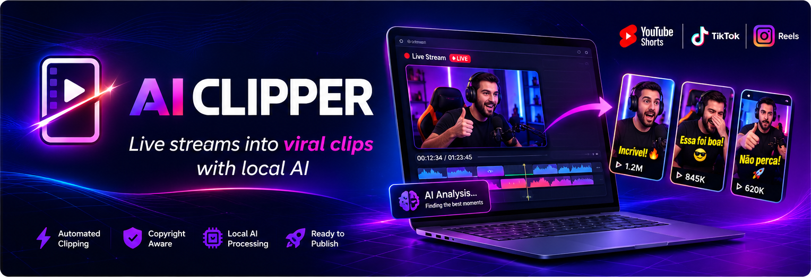



# AI Clipper

**Corta lives e vídeos em clipes verticais com IA, direto no seu computador.** Você revisa e aprova; ele publica no YouTube e no TikTok. *(English and Español below.)*

- Grava lives da Twitch em tempo real, pega a última live, clipes da Twitch, links e vídeos do computador.
- IA local escolhe os melhores momentos, um juiz com visão confere, e gera clipes 9:16 legendados com título, gancho e hashtags.
- Detecta e tira música protegida, mantendo a voz.
- Revisão no site ou no Telegram, publicação no YouTube e TikTok, métricas e aprendizado com as suas decisões.
- **100% local:** sem nuvem, sem servidor, sem conta no AI Clipper. Seus vídeos e dados não saem do seu computador.
- Português, English e Español. Tema escuro e claro.

| Revisão | Primeiros passos |
|---|---|
|  |  |

## Baixar e instalar

**[⬇ Baixar a última versão](https://github.com/Gabriel-Bastiani/ai-clipper-download/releases/latest)** (arquivo `AI-Clipper-Setup-X.Y.Z.exe`)

1. **Instalador (mais fácil):** abra o `.exe` e siga as telas; cada uma explica a escolha. Ele detecta a sua máquina e recomenda a IA certa. Se o Windows avisar "O Windows protegeu o computador", clique em **Mais informações → Executar assim mesmo** (o instalador ainda não tem o certificado pago do Windows).
2. **Com o Claude ou outra IA de código:** depois de instalar, abra a pasta do AI Clipper na IA e peça para ela ler o `GUIA-PARA-IA.md`.
3. **Manual:** baixe o `.zip` da Release, extraia e dê dois cliques em `Instalar AI Clipper.bat`.

**Requisitos:** Windows 10/11 64 bits. Placa NVIDIA recomendada (funciona sem, mais devagar). 20 a 60 GB livres em qualquer disco, conforme o modelo de IA, mais espaço para os vídeos.

## Atualizações

Ao ligar, o AI Clipper confere se há versão nova e já abre atualizado, com backup antes e volta automática se algo falhar. Com ele aberto, o sininho avisa. Cada versão é verificada por assinatura digital antes de ser instalada. As novidades ficam na tela **Sobre**.

## Privacidade e licença

Tudo roda no seu computador; o autor não recebe nenhum dado seu. Uso pessoal gratuito; não é permitido copiar, redistribuir, modificar ou fazer engenharia reversa: veja a [licença de uso](LICENSE.txt). Você é responsável por ter autorização para o conteúdo que corta e publica. Componentes de terceiros: [THIRD-PARTY-NOTICES.txt](THIRD-PARTY-NOTICES.txt).

Este repositório só tem os arquivos de instalação; o código-fonte é privado.

---

### English

AI Clipper cuts live streams and videos into vertical clips with AI, entirely on your computer. You review and approve; it publishes to YouTube and TikTok. **[Download the latest version](https://github.com/Gabriel-Bastiani/ai-clipper-download/releases/latest)**, run the installer and follow the screens (the site is available in English). Updates install automatically on start, verified by digital signature. Personal-use license, no redistribution or modification: see [LICENSE.txt](LICENSE.txt).

### Español

AI Clipper corta directos y vídeos en clips verticales con IA, todo en tu ordenador. Tú revisas y apruebas; publica en YouTube y TikTok. **[Descarga la última versión](https://github.com/Gabriel-Bastiani/ai-clipper-download/releases/latest)**, abre el instalador y sigue las pantallas (el sitio está en español). Las actualizaciones se instalan solas al iniciar, verificadas por firma digital. Licencia de uso personal, sin redistribución ni modificación: mira [LICENSE.txt](LICENSE.txt).
